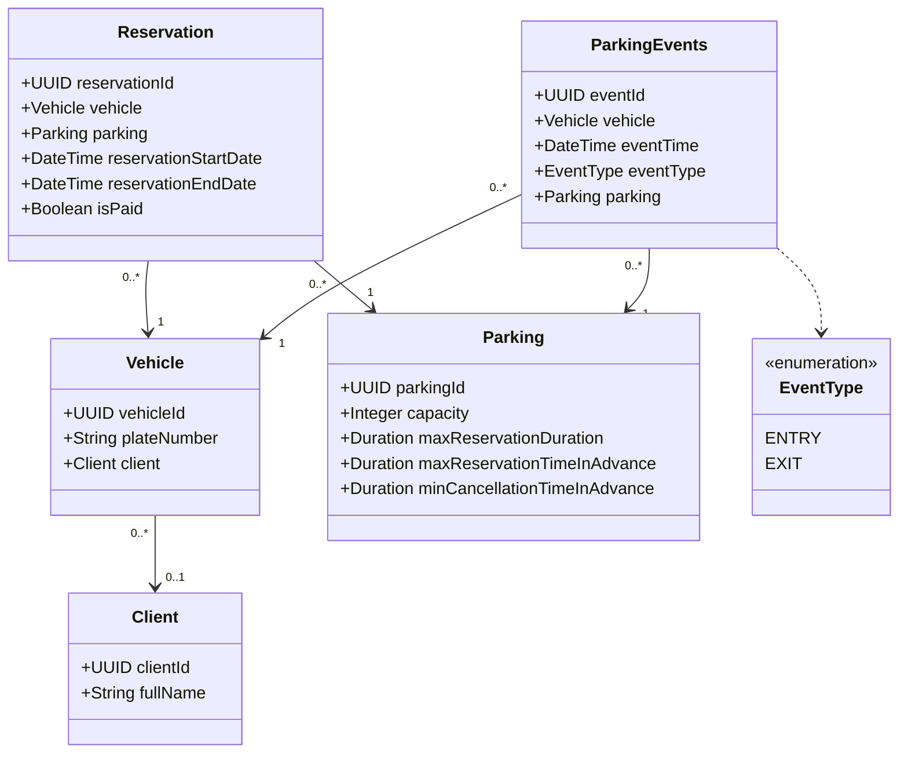

## 1 Model danych

*Słownik pojęć*

### Pojęcia występujące w modelu danych utrwalanych

**Klient (Client)** - osoba korzystająca z usług parkingowych. System przechowuje jej imię i nazwisko. 
Klient może mieć przypisanych wiele pojazdów.

**Pojazd (Vehicle)** - pojazd o wewnętrznym identyfikatorze systemowym (`vehicleId`) i numerze rejestracyjnym (`plateNumber`). 
System zapisuje dla niego rezerwacje i zdarzenia parkingowe. Pojazd może mieć przypisanego jednego klienta lub wcale 
nie mieć przypisania.

**Parking (Parking)** - obiekt udostępniający miejsca postojowe. Ma pojemność oraz limity czasu trwania rezerwacji, 
jej tworzenia z wyprzedzeniem i anulowania. System wiąże z nim rezerwacje i zdarzenia parkingowe.

**Rezerwacja (Reservation)** - gwarancja dostępności miejsca na danym parkingu dla jednego pojazdu w określonym czasie.
Obowiązuje od `reservationStartDate` do `reservationEndDate`. Pole `isPaid` określa, czy rezerwacja jest opłacona. 
Opłacona rezerwacja umożliwia wielokrotne wjazdy i wyjazdy w tym przedziale bez dodatkowych opłat.

**Zdarzenie parkingowe (ParkingEvents)** - zapis pojedynczego wjazdu pojazdu na parking albo wyjazdu z niego. 
System zapisuje pojazd, parking, czas wystąpienia (`eventTime`) i typ zdarzenia (`eventType`). 
Historia tych zdarzeń opisuje ruch pojazdów na parkingach.

**Typ zdarzenia (EventType)** - rodzaj zdarzenia parkingowego. Wartość `ENTRY` oznacza wjazd na parking, a `EXIT` wyjazd 
z parkingu.

### Pojęcia odpowiadające danym ulotnym przetwarzanym przez system

**Bieżąca zajętość parkingu** - liczba pojazdów obecnych na parkingu w danej chwili. System oblicza ją z zapisanych 
zdarzeń wjazdu i wyjazdu. Wyniku nie zapisuje w bazie.

**Bieżąca liczba niezajętych miejsc parkingowych** - pojemność parkingu pomniejszona o jego bieżącą zajętość. 
System oblicza tę wartość na żądanie i nie zapisuje jej w bazie. Przy tworzeniu nowej rezerwacji musi uwzględnić 
istniejące rezerwacje w wybranym terminie.

### Pozostałe pojęcia

**Pojemność parkingu (capacity)** - maksymalna liczba pojazdów, które mogą przebywać na parkingu w tej samej chwili.

**Maksymalny czas trwania rezerwacji (maxReservationDuration)** - najdłuższy dopuszczalny czas od początku do końca 
rezerwacji na danym parkingu.

**Maksymalne wyprzedzenie rezerwacji (maxReservationTimeInAdvance)** - najdłuższy dopuszczalny czas od utworzenia 
rezerwacji do jej rozpoczęcia.

**Minimalne wyprzedzenie anulowania rezerwacji (minCancellationTimeInAdvance)** - najkrótszy wymagany czas od anulowania 
rezerwacji do jej planowanego rozpoczęcia.

**Miejsce parkingowe** - miejsce przeznaczone do postoju jednego pojazdu. Model uwzględnia liczbę miejsc przez pojemność 
parkingu. Rezerwacja wskazuje parking, **BEZ** przypisania do konkretnego stanowiska.

**Postój** - czas ciągłej obecności pojazdu na parkingu od wjazdu do wyjazdu. W ramach jednej rezerwacji pojazd może 
odbyć kilka postojów. Zakończenie rezerwacji nie kończy trwającego postoju, a pojazd zajmuje miejsce na parkingu aż do 
wyjazdu.

*Diagram klas modelu*

