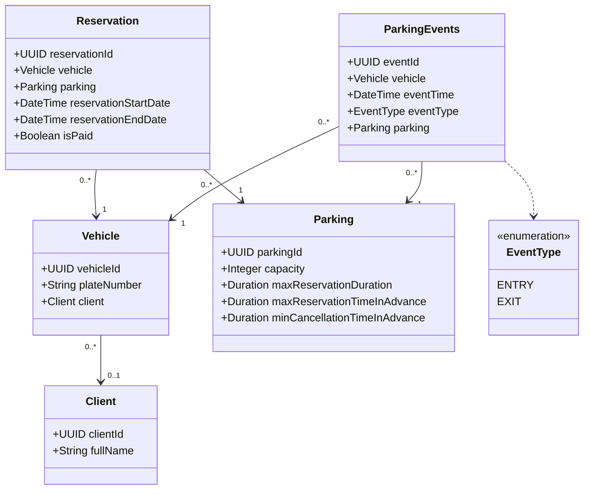

## 1 Model danych

*Słownik pojęć*

Słownik powinien objaśniać pojęcia dziedzinowe występujące w projekcie, z podziałem na:
* Pojęcia występujące w modelu danych utrwalanych w ramach projektu (odwzorowanych w diagramie klas modelu dziedzinowego)
* Pojęcia odpowiadające danym ulotnym przetwarzanym przez system, o ile występują
* Pozostałe pojęcia, o ile występują

Słownik wymienia pojęcia w języku polskim. Jeżeli w realizacji projektu używane są identyfikatory anglojęzyczne należy podać anglojęzyczne odpowiedniki w nawiasie.

*Diagram klas modelu*

