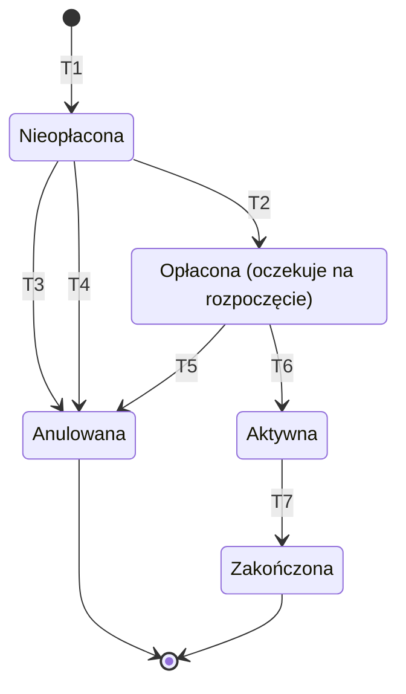
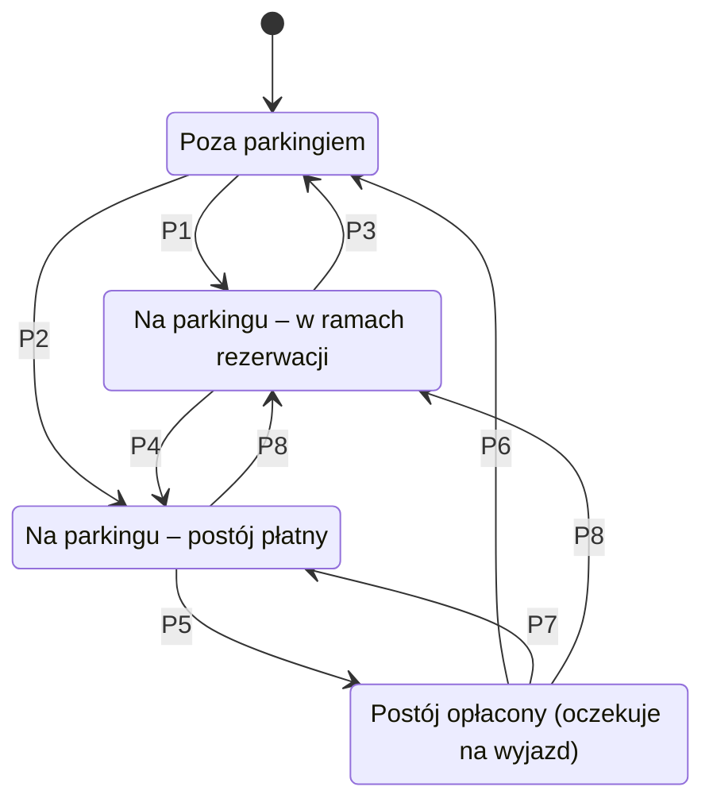

## 2 Wymagania funkcjonalne
*Słownik aktorów*

- Klient
- Gość
- System

Słownik aktorów (ról) powinien zawierać wszystkie role występujące w modelu dziedzinowym projektu.

*Diagramy przypadków użycia*

Dla każdej z wymienionych ról wymagany jest diagram UML przypadków użycia występujących w modelu dziedzinowym projektu, bez uwzględniania przypadków użycia związanych z technicznym aspektem uwierzytelniania, kontroli dostępu i obsługi kont systemu.

Jeżeli w modelu dziedzinowym występują przypadki użycia dostępne dla użytkownika nieuwierzytelnionego (anonimowego) należy wykazać taką rolę i zamieścić odpowiedni diagram.

Jeżeli w modelu dziedzinowym występują przypadki użycia realizowane automatycznie (nie z inicjatywy użytkownika, np. wyzwalane czasowo) należy wykazać rolę System i zamieścić odpowiedni diagram.

*Diagramy stanów / przejść*

Diagramy obejmują obiekty modelu dziedzinowego, które w swoim cyklu życia zmieniają znaczenie dziedzinowe:
* **Rezerwacja** (`Reservation`),
* **Pojazd** (`Vehicle`) w kontekście pobytu na Parkingu – stan wyznaczany na podstawie zdarzeń wjazdu i wyjazdu (`ParkingEvents`) oraz rezerwacji.

Pominięto:
* **Parking** – zmiana pojemności lub parametrów rezerwacji jest edycją danych, a nie zmianą stanu,
* **Klient** – zmiany stanu konta użytkownika nie są objęte diagramami,
* przypisanie Pojazdu do Klienta – jest to zbudowanie / porzucenie związku z innym obiektem, które nie jest traktowane jako zmiana stanu.

Oznaczenia używane w warunkach: `teraz` – bieżący czas, `start` / `koniec` – `reservationStartDate` / `reservationEndDate`.

**Rezerwacja**

| Przejście | Opis (rola: akcja / warunki) |
|---|---|
| T1 | Klient: utwórz rezerwację / pojazd przypisany do Klienta; `start − teraz ≤ maxReservationTimeInAdvance`; `koniec − start ≤ maxReservationDuration`; liczba rezerwacji na danym Parkingu nakładających się na przedział `[start, koniec]` mniejsza od limitu miejsc podlegających rezerwacjom; liczba bieżących i przyszłych rezerwacji Klienta mniejsza od limitu |
| T2 | Klient: opłać rezerwację / `teraz < start`; płatność zakończona powodzeniem (`isPaid = true`) |
| T3 | Klient: odwołaj rezerwację / `teraz < start` |
| T4 | System: anuluj nieopłaconą rezerwację (wyzwalane czasowo) / `teraz ≥ start` i rezerwacja nie została opłacona; miejsce zostaje zwolnione |
| T5 | Klient: odwołaj rezerwację / `teraz ≤ start − minCancellationTimeInAdvance` |
| T6 | System: rozpocznij rezerwację (wyzwalane czasowo) / `teraz ≥ start` |
| T7 | System: zakończ rezerwację (wyzwalane czasowo) / `teraz ≥ koniec` |
Wjazdy i wyjazdy pojazdu nie zmieniają stanu Rezerwacji – w stanie *Aktywna* umożliwia ona swobodne wjazdy i wyjazdy bez kolejnych opłat, co opisuje diagram pobytu Pojazdu (P1, P3). Rozpoczęcie (T6) i zakończenie (T7) rezerwacji wyzwalają odpowiednio przejścia P8 i P4 pobytu Pojazdu, jeżeli pojazd znajduje się w tym czasie na parkingu.

Wariant: jeżeli płatność jest realizowana atomowo w ramach utworzenia rezerwacji, stan *Nieopłacona* oraz przejścia T3 i T4 nie występują, a T1 prowadzi bezpośrednio do stanu *Opłacona*.

**Pojazd – pobyt na Parkingu**

| Przejście | Opis (rola: akcja / warunki) |
|---|---|
| P1 | System: zarejestruj wjazd / pojazd posiada aktywną rezerwację na danym Parkingu |
| P2 | System: zarejestruj wjazd / brak aktywnej rezerwacji; liczba pojazdów na parkingu bez rezerwacji mniejsza niż `capacity − liczba aktywnych rezerwacji`; jeżeli pojazd nie istnieje w Systemie, zostaje automatycznie zarejestrowany (bez powiązania z Klientem) |
| P3 | System: zarejestruj wyjazd / rezerwacja nadal aktywna – bez opłaty |
| P4 | System: zakończ rezerwację / pojazd znajduje się na parkingu w chwili `koniec`; opłata naliczana od momentu zakończenia rezerwacji |
| P5 | Gość lub Klient: opłać postój (w terminalu) / opłata wyliczona na podstawie czasu od wjazdu (lub od zakończenia rezerwacji) uiszczona w całości |
| P6 | System: zarejestruj wyjazd / czas od opłacenia nie przekracza dopuszczalnego czasu na opuszczenie parkingu |
| P7 | System: przekroczono czas na wyjazd (wyzwalane czasowo) / czas od opłacenia przekracza dopuszczalny czas na opuszczenie parkingu; naliczana jest dopłata |
| P8 | System: rozpocznij rezerwację / pojazd wjechał przed `start` i nadal znajduje się na parkingu; opłata za czas od wjazdu do `start` (pomniejszona o kwotę już uiszczoną) doliczana jest do rozliczenia Rezerwacji Klienta |

Odmowa wjazdu (brak wolnego miejsca dla pojazdu bez aktywnej rezerwacji) nie zmienia stanu – pojazd pozostaje *Poza parkingiem*, a zdarzenie wjazdu nie jest utrwalane.

Stan pobytu nie jest utrwalany jako osobny atrybut – wynika z ostatniego zdarzenia `ParkingEvents` danego Pojazdu na danym Parkingu oraz z aktywnej rezerwacji.
