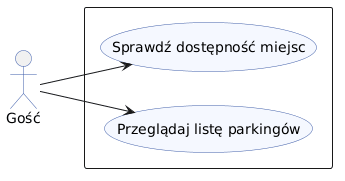
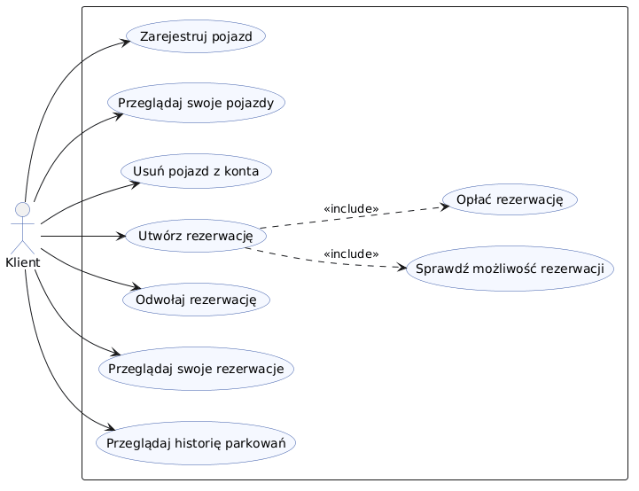
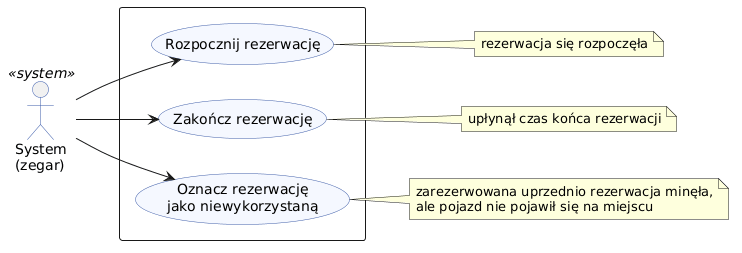
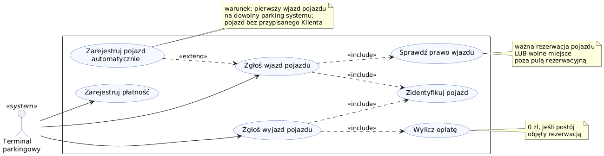
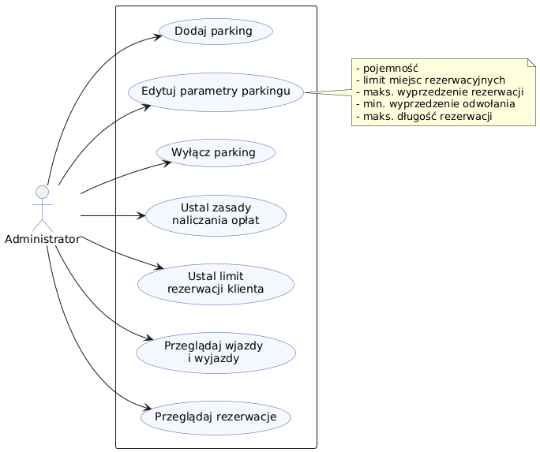
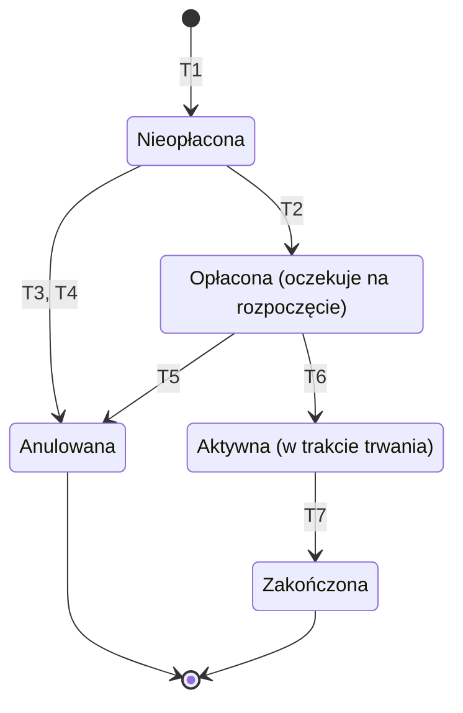
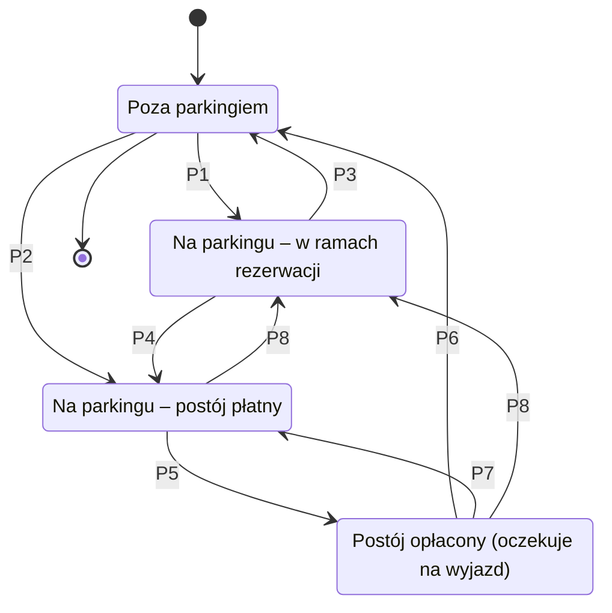

## 2 Wymagania funkcjonalne
*Słownik aktorów*

| Aktor               | Opis roli aktora                                                                                                                                                                                                                                                                                                                                 |
|---------------------|--------------------------------------------------------------------------------------------------------------------------------------------------------------------------------------------------------------------------------------------------------------------------------------------------------------------------------------------------|
| Gość                | Użytkownik bez uwierzytelnienia. Korzysta z funkcjonalności dostępnych bez logowania.                                                                                                                                                                                                                                                            |
| Klient              | Uwierzytelniony użytkownik korzystający z usług parkingowych dla przypisanych mu pojazdów i ich rezerwacji. Obiekt `Client` zawiera jego dane.                                                                                                                                                                                                   |
| System              | Aktor wykonujący działania bez inicjatywy użytkownika, w tym zadania wyzwalane czasowo.                                                                                                                                                                                                                                                          |
| Terminal parkingowy | Zewnętrzny system (urządzenie dostawcy) komunikujący się z systemem centralnym przez REST. Zgłasza wjazdy i wyjazdy pojazdów rozpoznanych po numerze rejestracyjnym, na tej podstawie powstają obiekty `ParkingEvents`. Przy pierwszym wjeździe nieznanego pojazdu powoduje jego automatyczną rejestrację (`Vehicle` bez przypisanego `Client`). |
| Administrator       | Uwierzytelniony pracownik Przedsiębiorstwa zarządzający danymi parkingów (`Parking`): dodaje je i ustala ich parametry (pojemność oraz limity czasowe rezerwacji). Ma wgląd w rezerwacje i zdarzenia wjazdu/wyjazdu na wszystkich parkingach.                                                                                                    |

W modelu danych klient ma odpowiednik w klasie `Client`. Gość, System, Terminal parkingowy i Administrator są rolami bez odrębnych klas.

*Diagramy przypadków użycia*

Wykres 1.2.1 - Diagram przypadków użycia dla aktora Gość

Wykres 1.2.2 - Diagram przypadków użycia dla aktora Klient

Wykres 1.2.3 - Diagram przypadków użycia dla aktora System

Wykres 1.2.4 - Diagram przypadków użycia dla aktora Terminal parkingowy

Wykres 1.2.5 - Diagram przypadków użycia dla aktora Administrator

*Diagramy stanów / przejść*

Diagramy obejmują obiekty modelu dziedzinowego, które w swoim cyklu życia zmieniają znaczenie dziedzinowe:

* **Rezerwacja** (`Reservation`),
* **Pojazd** (`Vehicle`) w kontekście postoju na Parkingu – cykl życia obecności/wizyty na obiekcie `Parking` wyznaczany
  wprost na podstawie utrwalanych zdarzeń `ParkingEvents` (`ENTRY`, `EXIT`) oraz powiązanej rezerwacji.

Pominięto:

* **Parking** – zmiana pojemności (`capacity`) lub parametrów czasowych rezerwacji jest standardową modyfikacją
  atrybutów obiektu, a nie przejściem między stanami w cyklu życia,
* **Klient** – zmiany stanu konta użytkownika nie są objęte zakresem diagramów stanów dziedzinowych,
* przypisanie Pojazdu do Klienta – jest to powiązanie referencyjne (relacja `Vehicle "0..*" --> "0..1" Client`), a nie
  zmiana stanu samego obiektu.

Oznaczenia używane w warunkach (odnoszące się bezpośrednio do atrybutów modelu danych):

* `teraz` – bieżący czas systemowy,
* `start` – `reservationStartDate` z encji `Reservation`,
* `koniec` – `reservationEndDate` z encji `Reservation`.

---

**1. Rezerwacja (`Reservation`)**

Cykl życia obiektu `Reservation` wyznaczany jest przez atrybut `isPaid` oraz relację czasu bieżącego `teraz` do
przedziału czasowego `[reservationStartDate, reservationEndDate]`, z uwzględnieniem parametrów obiektu `Parking`
(`maxReservationTimeInAdvance`, `maxReservationDuration`, `minCancellationTimeInAdvance`).

| Przejście | Opis (rola: akcja / warunki)                                                                                                                                                                                                                                                                                                                                                                                              |
|-----------|---------------------------------------------------------------------------------------------------------------------------------------------------------------------------------------------------------------------------------------------------------------------------------------------------------------------------------------------------------------------------------------------------------------------------|
| T1        | Klient: utwórz rezerwację / pojazd przypisany do Klienta (`vehicle.client == client`), `start - teraz ≤ parking.maxReservationTimeInAdvance`, `koniec - start ≤ parking.maxReservationDuration` oraz liczba istniejących rezerwacji na danym Parkingu nakładających się na przedział `[start, koniec]` mniejsza od limitu miejsc podlegających rezerwacji (`parking.capacity`). Nowo utworzony obiekt ma `isPaid = false` |
| T2        | Klient: opłać rezerwację / `teraz < start` i płatność zrealizowana poprawnie. Atrybut `isPaid` przyjmuje wartość `true`                                                                                                                                                                                                                                                                                                   |
| T3        | Klient: odwołaj rezerwację / `teraz < start`. Nieopłacona rezerwacja (`isPaid = false`) zostaje anulowana                                                                                                                                                                                                                                                                                                                 |
| T4        | System: anuluj nieopłaconą rezerwację (wyzwalane czasowo) / `teraz ≥ start` oraz `isPaid = false`. Zarezerwowane miejsce zostaje zwolnione                                                                                                                                                                                                                                                                                |
| T5        | Klient: odwołaj rezerwację / `teraz ≤ start − parking.minCancellationTimeInAdvance`. Opłacona rezerwacja (`isPaid = true`) zostaje anulowana, a środki zwrócone                                                                                                                                                                                                                                                           |
| T6        | System: rozpocznij rezerwację (wyzwalane czasowo) / `teraz ≥ start` oraz `isPaid = true`                                                                                                                                                                                                                                                                                                                                  |
| T7        | System: zakończ rezerwację (wyzwalane czasowo) / `teraz ≥ koniec`                                                                                                                                                                                                                                                                                                                                                         |

Wjazdy i wyjazdy pojazdu nie modyfikują stanu samej Rezerwacji - stan *Aktywna* uprawnia pojazd do wjazdu i wyjazdu w
zdefiniowanym oknie czasowym bez naliczania dodatkowych opłat, co odzwierciedla diagram postoju Pojazdu (przejścia P1,
P3). Rozpoczęcie (T6) oraz zakończenie (T7) rezerwacji synchronizują stan postoju pojazdu na parkingu (przejścia P8 i
P4).

*Wariant jednofazowy:* Jeżeli w architekturze systemu płatność pobierana jest atomowo podczas składania rezerwacji, stan
*Nieopłacona* oraz przejścia T2, T3 i T4 nie występują, a akcja T1 tworzy obiekt od razu z flagą `isPaid = true` w
stanie *Opłacona*.

---

**2. Pojazd – postój na Parkingu (`Vehicle`)**

Cykl życia obecności Pojazdu opiera się wprost na rejestrowaniu zdarzeń w tabeli `ParkingEvents` (`EventType.ENTRY`,
`EventType.EXIT`) powiązanych z danym `Vehicle` i `Parking`:

* Pojazd bez przypisanego klienta (`client == null` w klasie `Vehicle`) reprezentuje pojazd **Gościa** (użytkownika
  niezarejestrowanego/anonimowego), co bezpośrednio realizuje krotność `0..1` relacji `Vehicle` z `Client`.
* Fizyczna obecność na terenie parkingu wynika z faktu, że ostatnim zarejestrowanym zdarzeniem w `ParkingEvents` dla
  danego pojazdu i parkingu jest `ENTRY`.
* Zdarzenia szlabanowe `ENTRY` i `EXIT` są trwale rejestrowane w bazie (`ParkingEvents`), natomiast uiszczenie opłaty za
  postój w terminalu (P5) stanowi autoryzację wyjazdu ważną przez dopuszczalny czas na opuszczenie parkingu
  (`EXIT_GRACE_PERIOD`).

| Przejście | Opis (rola: akcja / warunki)                                                                                                                                                                                                                                                                                                                                          |
|-----------|-----------------------------------------------------------------------------------------------------------------------------------------------------------------------------------------------------------------------------------------------------------------------------------------------------------------------------------------------------------------------|
| P1        | System: zarejestruj wjazd (zapis `ParkingEvents` z `eventType = ENTRY`) / pojazd posiada aktywną rezerwację na danym Parkingu (`isPaid = true` oraz `start ≤ teraz ≤ koniec`). Szlaban wjazdowy podnosi się bez pobierania biletu                                                                                                                                     |
| P2        | System: zarejestruj wjazd (zapis `ParkingEvents` z `eventType = ENTRY`) / brak aktywnej rezerwacji oraz liczba pojazdów na parkingu bez aktywnej rezerwacji mniejsza niż `parking.capacity - liczba_aktywnych_rezerwacji`. Jeżeli numer rejestracyjny (`plateNumber`) nie występuje w bazie, tworzony jest obiekt `Vehicle` z relacją `client = null` (pojazd Gościa) |
| P3        | System: zarejestruj wyjazd (zapis `ParkingEvents` z `eventType = EXIT`) / rezerwacja nadal aktywna (`teraz ≤ koniec`). Wyjazd odbywa się bez naliczania opłaty                                                                                                                                                                                                        |
| P4        | System: zakończ rezerwację (wyzwalane czasowo przez T7) / `teraz ≥ koniec`, a ostatnim zdarzeniem pojazdu w `ParkingEvents` jest `ENTRY` (pojazd nie opuścił parkingu przed upływem rezerwacji). Od momentu `koniec` naliczana jest opłata standardowa za postój płatny                                                                                               |
| P5        | Gość lub Klient: opłać postój (w terminalu) / opłata wyliczona na podstawie czasu od ostatniego `ENTRY` (lub od momentu `koniec` rezerwacji przy P4) uiszczona w całości. System odnotowuje autoryzację wyjazdu                                                                                                                                                       |
| P6        | System: zarejestruj wyjazd (zapis `ParkingEvents` z `eventType = EXIT`) / czas od opłacenia (P5) nie przekracza dopuszczalnego czasu na opuszczenie parkingu (`teraz − czas_opłacenia ≤ EXIT_GRACE_PERIOD`). Szlaban wyjazdowy podnosi się                                                                                                                            |
| P7        | System: przekroczono czas na wyjazd (wyzwalane czasowo) / `teraz − czas_opłacenia > EXIT_GRACE_PERIOD` przy braku zdarzenia `EXIT`. Autoryzacja wygasa i następuje powrót do naliczania opłaty za dodatkowy czas postoju                                                                                                                                              |
| P8        | System: rozpocznij rezerwację (wyzwalane czasowo przez T6) / `teraz ≥ start`, a pojazd znajduje się już na parkingu (ostatnim zdarzeniem jest `ENTRY`). Ewentualna opłata za wcześniejszy postój (od wjazdu do `start`) zostaje doliczona do rozliczenia Klienta, a dalszy postój przechodzi pod aktywną rezerwację                                                   |

Odmowa wjazdu (brak wolnego miejsca dla pojazdu bez rezerwacji przy wyczerpaniu puli z `parking.capacity`) nie powoduje
zmiany stanu – pojazd pozostaje w stanie *Poza parkingiem*, a zdarzenie w `ParkingEvents` nie jest rejestrowane.

Stan postoju nie wymaga osobnego atrybutu w klasie `Vehicle` - wynika bezpośrednio z korelacji ostatniego
zarejestrowanego zdarzenia `ParkingEvents` danego pojazdu na danym obiekcie `Parking` oraz stanu powiązanego obiektu
`Reservation`.
