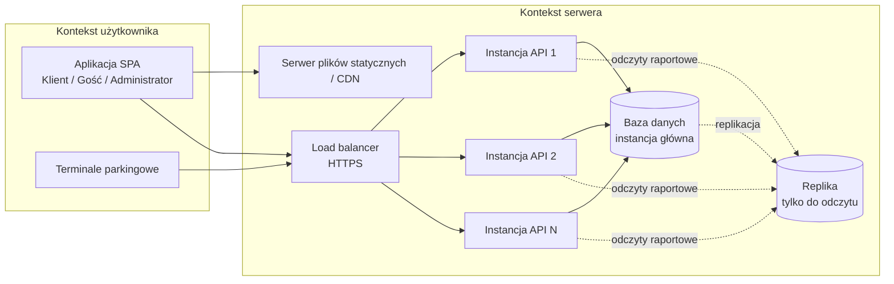

## 3 Architektura
*Diagram perspektywy wdrożenia*

Wykres 2.1.1 - Diagram perspektywy wdrożenia

*Stan konwersacyjny*

Stan konwersacyjny systemu z użytkownikiem jest przechowywany w warstwie klienta - w aplikacji SPA uruchamianej w przeglądarce użytkownika systemu. Aplikacja warstwy logiki nie utrzymuje sesji: każde żądanie zawiera token i komplet danych potrzebnych do jego obsługi, dzięki czemu warstwa logiki jest bezstanowa.

*Udostępnienie systemu*

**Protokół komunikacji**

Kontekst użytkownika komunikuje się z kontekstem serwera protokołem HTTPS. Z protokołu korzystają oba rodzaje klientów:

* aplikacja SPA w przeglądarce pobiera pliki statyczne z serwera plików / CDN i wywołuje REST API warstwy logiki, przesyłając dane w formacie JSON,
* terminale parkingowe zgłaszają do tego samego REST API wjazdy, wyjazdy i opłacenie postoju.

Nieszyfrowany HTTP służy wyłącznie do przekierowania użytkownika na adres HTTPS i nie obsługuje żadnych żądań API.

**Zagrożenia dla przesyłanych danych**

Między klientem a serwerem przesyłane są hasła przy logowaniu, JWT tokeny dostępu, dane osobowe Klientów, rezerwacje oraz zdarzenia, od których zależy podniesienie szlabanu parkingu. Dane te przechodzą przez sieci, których nie kontroluje ani użytkownik, ani administrator systemu (publiczne Wi-Fi, sieć operatora komórkowego, Internet), dlatego narażone są na następujące ataki:

| Zagrożenie                                          | Na czym polega                                                                                                   | Skutek w systemie                                                                                                                         |
|-----------------------------------------------------|------------------------------------------------------------------------------------------------------------------|-------------------------------------------------------------------------------------------------------------------------------------------|
| Podsłuch (*eavesdropping, sniffing*)                | Atakujący w tej samej sieci przechwytuje i odczytuje przesyłane pakiety                                          | Ujawnienie haseł i danych osobowych (naruszenie RODO), poznanie numerów rejestracyjnych i historii postojów                                |
| Przechwycenie tokenu (*session hijacking*)          | Atakujący odczytuje token JWT z nagłówka żądania i dołącza go do własnych żądań                                 | Podszycie się pod Klienta lub Administratora do czasu wygaśnięcia tokenu: anulowanie cudzych rezerwacji, zmiana parametrów parkingu       |
| Modyfikacja danych (*man-in-the-middle*)            | Atakujący pośredniczy w połączeniu i zmienia treść żądań lub odpowiedzi                                          | Zmiana pojazdu, terminu lub parkingu w rezerwacji, podmiana odpowiedzi o opłacie, sfałszowana autoryzacja wyjazdu                          |
| Podszycie się pod serwer (*spoofing*, phishing)     | Klient zostaje skierowany na fałszywy serwer (np. przez fałszywy punkt dostępowy Wi-Fi lub atak na DNS)          | Użytkownik wpisuje hasło na stronie atakującego, terminal wysyła zdarzenia do niewłaściwego odbiorcy                                       |
| Podszycie się pod terminal                          | Dowolne urządzenie wysyła do API żądania w imieniu terminala                                                    | Fałszywe zdarzenia `ENTRY`/`EXIT` i opłacenia postoju, czyli otwarcie szlabanu bez zapłaty i błędna zajętość parkingu                     |
| Powtórzenie żądania (*replay*)                      | Atakujący zapisuje poprawne żądanie i wysyła je ponownie później                                                 | Zdublowane zdarzenia wjazdu i wyjazdu, ponowna autoryzacja wyjazdu                                                                        |
| Obniżenie poziomu zabezpieczeń (*downgrade*)        | Atakujący wymusza połączenie przez zwykłe HTTP lub przestarzałą wersję SSL/TLS ze słabym szyfrowaniem             | Otwarcie drogi dla wszystkich powyższych ataków                                                                                           |

**Ochrona danych**

Standardowym rozwiązaniem tych zagrożeń jest protokół **TLS**, na którym opiera się HTTPS. Zapewnia on trzy właściwości kanału komunikacji:

* poufność - po uzgodnieniu kluczy sesji cała treść żądań i odpowiedzi (w tym nagłówek `Authorization` z tokenem i hasła) jest szyfrowana, więc podsłuch i kradzież tokenu z sieci nie są możliwe,
* integralność - każdy rekord TLS jest chroniony kodem uwierzytelniającym (szyfry AEAD, np. AES-GCM), więc zmiana danych w drodze zostaje wykryta i połączenie jest zrywane,
* uwierzytelnienie serwera - serwer przedstawia certyfikat X.509 wystawiony dla domeny systemu przez zaufany urząd certyfikacji. Przeglądarka i terminal sprawdzają certyfikat i nazwę domeny, więc fałszywy serwer nie nawiąże z nimi połączenia.

TLS chroni też przed powtórzeniem pakietów wewnątrz połączenia, bo każdy rekord ma numer sekwencyjny. Przed pozostałymi zagrożeniami chronią następujące ustawienia:

* konfiguracja TLS - tylko TLS 1.2 i 1.3, wyłączone przestarzałe szyfry, szyfry z utajnianiem przekazywania (*forward secrecy*, ECDHE), dzięki którym przechwycony dziś ruch nie zostanie odszyfrowany nawet po wycieku klucza serwera,
* HSTS (nagłówek `Strict-Transport-Security`) - przeglądarka po pierwszej wizycie łączy się z systemem wyłącznie przez HTTPS, co uniemożliwia atak *downgrade* przez przekierowanie na HTTP,
* wzajemne uwierzytelnienie terminali (mTLS) - każdy terminal ma własny certyfikat klienta wystawiony przez wewnętrzny urząd certyfikacji systemu. Load balancer przyjmuje żądania do punktów końcowych terminali tylko od urządzeń z ważnym certyfikatem, więc inne urządzenie nie może podszyć się pod terminal. Certyfikat skradzionego terminala unieważnia się bez wpływu na pozostałe,
* krótki czas ważności tokenów JWT - ogranicza skutki ewentualnego wycieku tokenu poza kanałem sieciowym (np. z urządzenia użytkownika). Mechanizm wydawania i weryfikacji tokenów opisano w rozdz. 7,
* klucz idempotencji w zdarzeniach terminala - ponownie wysłane zgłoszenie wjazdu lub wyjazdu nie tworzy drugiego zdarzenia.

Połączenie TLS z klientem kończy się na load balancerze, który ma certyfikat domeny. Ruch dalej, między load balancerem, instancjami API i bazą danych, odbywa się w wydzielonej sieci wewnętrznej, do której nie ma dostępu z zewnątrz.

*Skalowalność*

Skalowanie horyzontalne polega na uruchomieniu kilku identycznych instancji danego komponentu i rozdzielaniu między nie
ruchu. Ocenę przeprowadzono osobno dla każdej warstwy zaproponowanej architektury: klient przeglądarkowy (SPA)
i terminale parkingowe → REST API (warstwa logiki) → relacyjna baza danych (warstwa danych) oraz zadania wyzwalane
czasowo (aktor *System*).

Wykres 2.1.2 - Skalowanie horyzontalne warstwy logiki systemu

**1. Warstwa prezentacji (SPA)**

Aplikacja kliencka to zbiór statycznych plików (HTML, JS, CSS) wykonywanych w przeglądarce użytkownika. Serwer jedynie je
udostępnia, więc można je powielić na dowolnej liczbie serwerów lub umieścić w sieci CDN bez żadnej koordynacji między
instancjami. Ta warstwa skaluje się horyzontalnie bez ograniczeń.

**2. Warstwa logiki biznesowej (REST API) - skalowanie możliwe i zalecane**

Warunkiem multiplikowania instancji serwera aplikacji jest jego **bezstanowość**: żadne żądanie nie może zależeć od
danych zapamiętanych w pamięci konkretnej instancji przy poprzednim żądaniu. W proponowanej architekturze warunek ten
jest spełniony:

* stan konwersacyjny przechowuje klient - każde żądanie niesie token dostępu (JWT, zob. rozdz. 7), który każda instancja
  weryfikuje samodzielnie na podstawie wspólnego klucza. Nie jest potrzebna sesja HTTP po stronie serwera ani
  mechanizm *sticky sessions* na load balancerze,
* stan dziedzinowy (rezerwacje, zdarzenia w tabeli `parking_events`, autoryzacja wyjazdu po opłaceniu postoju - P5) jest
  utrwalany w bazie danych, a nie w pamięci instancji,
* dane ulotne (bieżąca zajętość, liczba wolnych miejsc) są wyliczane na żądanie z bazy, więc każda instancja otrzymuje
  ten sam wynik.

Przed instancjami API umieszcza się load balancer (np. Nginx, HAProxy lub ingress Kubernetesa), który rozdziela żądania
algorytmem round-robin / least-connections, terminuje TLS i usuwa z puli instancje, które nie odpowiadają na sondę
`/health`. Dzięki temu dodawanie i usuwanie instancji (np. w reakcji na obciążenie) nie wymaga zmian po stronie
klientów ani terminali.

Skalowanie horyzontalne wymusza jednak kilka decyzji projektowych:

| Problem                                                     | Skutek przy N instancjach                                                                                                                       | Rozwiązanie                                                                                                                                                                                                                     |
|-------------------------------------------------------------|-------------------------------------------------------------------------------------------------------------------------------------------------|---------------------------------------------------------------------------------------------------------------------------------------------------------------------------------------------------------------------------------|
| Kontrola limitu miejsc (T1, P2)                             | Blokady w pamięci procesu (np. `sync.Mutex`) chronią tylko w obrębie jednej instancji. Dwie instancje mogą jednocześnie przekroczyć `capacity`   | Synchronizacja na poziomie bazy danych: blokada wiersza parkingu w tabeli `parking` (`SELECT ... FOR UPDATE`) w transakcji tworzącej rezerwację (zob. rozdz. 5)                                                               |
| Zadania wyzwalane czasowo (T4, T6, T7, P4, P7)              | Harmonogram uruchomiony w każdej instancji wykona to samo zadanie N razy (np. wielokrotne anulowanie lub zwrot środków)                          | Zadania działają w każdej instancji `parking-api` (`time.Ticker`), ale przed wykonaniem instancja pobiera blokadę doradczą w bazie (`pg_try_advisory_xact_lock` z identyfikatorem zadania). Zadanie wykonuje tylko instancja, której się to udało, a pozostałe pomijają ten cykl. Dodatkowo operacje są warunkowe, np. `UPDATE ... WHERE is_paid = false AND ...`, dzięki czemu powtórzenie nic nie zmienia |
| Ponowienie żądania przez terminal                           | Terminal po przekroczeniu czasu odpowiedzi może ponowić zgłoszenie wjazdu do innej instancji, co da zdublowane zdarzenie `ENTRY`                | Idempotentny endpoint: terminal przesyła unikalny identyfikator zdarzenia (klucz idempotencji), a baza ma na nim ograniczenie unikalności                                                                                     |
| Pamięć podręczna (cache)                                    | Lokalny cache każdej instancji może zwracać nieaktualną zajętość parkingu                                                                       | Nie buforować danych zmiennych (zajętość) albo użyć współdzielonego cache (np. Redis) z unieważnianiem przy zapisie. Lokalny cache tylko dla danych rzadko zmienianych (wiersz tabeli `parking`)                                    |
| Klucz podpisu tokenów, konfiguracja                         | Token wydany przez jedną instancję musi być akceptowany przez pozostałe                                                                         | Wspólny klucz/para kluczy i konfiguracja wstrzykiwane wszystkim instancjom (zmienne środowiskowe, menedżer sekretów)                                                                                                         |
| Identyfikatory encji                                        | Liczniki generowane w pamięci instancji kolidowałyby ze sobą                                                                                   | Identyfikatory `UUID` (zgodnie z modelem danych) generowane niezależnie w każdej instancji                                                                                                                                    |

**3. Warstwa danych - skalowanie ograniczone**

Relacyjna baza danych jest jedynym komponentem współdzielonym przez wszystkie instancje API i to ona wyznacza granicę
skalowalności systemu. Zapisy (tworzenie rezerwacji, rejestracja wjazdów i wyjazdów) wymagają silnej spójności, bo
reguły limitu miejsc muszą być sprawdzane na aktualnych danych. Dlatego zapisy obsługuje jedna instancja główna
(*primary*). Możliwe są natomiast:

* **repliki tylko do odczytu** - przejmują zapytania niewymagające najświeższych danych, np. przegląd historii
  rezerwacji i zdarzeń przez Administratora czy raporty. Odczyty, na podstawie których podejmowana jest decyzja
  (wolne miejsca przy T1 i P2), muszą trafiać do instancji głównej, bo replikacja wprowadza opóźnienie,
* **pula połączeń** - przy N instancjach API łączna liczba połączeń rośnie N-krotnie, więc należy ograniczyć pule
  w instancjach lub zastosować pośrednika (np. PgBouncer),
* **partycjonowanie (sharding) według `parking_id`** - wszystkie reguły biznesowe (pojemność, limity czasowe, zajętość)
  dotyczą pojedynczego parkingu, więc dane różnych parkingów można by rozdzielić między niezależne bazy bez transakcji
  rozproszonych. Jest to naturalna ścieżka rozwoju przy bardzo dużej liczbie parkingów, ale przy obecnej skali
  niepotrzebna,
* **replikacja z automatycznym przełączaniem (failover)** - służy przede wszystkim dostępności, a nie wydajności.

Tabela `parking_events` rośnie stale, a bieżąca zajętość jest z niej wyliczana. Aby ten odczyt nie spowalniał się wraz
z historią, należy zastosować indeks (`parking_id`, `vehicle_id`, `event_time`) oraz ewentualnie partycjonowanie tabeli
po czasie i archiwizację starych zdarzeń.

**4. Ocena końcowa**

| Komponent                    | Skalowanie horyzontalne | Uwagi                                                                         |
|------------------------------|-------------------------|-------------------------------------------------------------------------------|
| SPA (pliki statyczne)        | Pełne                   | Serwer plików / CDN                                                           |
| REST API (warstwa logiki)    | Pełne                   | Bezstanowe instancje za load balancerem, blokady i idempotencja po stronie bazy |
| Zadania wyzwalane czasowo    | Ograniczone             | Jedno wykonanie na raz dzięki blokadzie doradczej w bazie                      |
| Baza danych - odczyty        | Możliwe                 | Repliki do odczytu dla zapytań raportowych                                    |
| Baza danych - zapisy         | Ograniczone             | Jedna instancja główna; w przyszłości sharding po `parking_id`                |

Zaproponowana architektura pozwala na skalowanie horyzontalne warstwy logiki bez zmian w kodzie biznesowym, o ile od
początku zachowa się wymienione zasady: brak stanu w pamięci instancji, kontrola współbieżności w bazie danych,
pojedyncze wykonanie zadań harmonogramu i idempotentne endpointy dla terminali. Przy przewidywanej skali systemu
(ruch generowany przez terminale kilku–kilkunastu parkingów i klientów) jedna instancja API wystarczy pod względem
wydajności. Zaleca się jednak uruchomienie co najmniej dwóch instancji, aby awaria lub aktualizacja jednej z nich nie
zatrzymywała obsługi szlabanów. Wąskim gardłem pozostaje instancja główna bazy danych, którą w razie potrzeby skaluje
się najpierw wertykalnie, a dopiero później przez repliki i partycjonowanie.