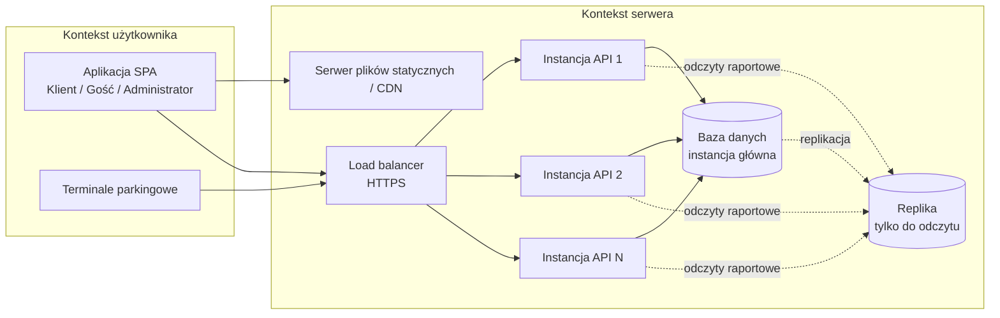

## 3 Architektura
*Diagram perspektywy wdrożenia*

Wykres 2.1.1 - Diagram perspektywy wdrożenia

*Stan konwersacyjny*

Stan konwersacyjny systemu z użytkownikiem jest przechowywany w warstwie klienta - w aplikacji SPA uruchamianej w przeglądarce użytkownika systemu. Aplikacja warstwy logiki nie utrzymuje sesji: każde żądanie zawiera token i komplet danych potrzebnych do jego obsługi, dzięki czemu warstwa logiki jest bezstanowa.

*Udostępnienie systemu*

**Protokół komunikacji**

Kontekst użytkownika komunikuje się z kontekstem serwera protokołem HTTPS. Z protokołu korzystają oba rodzaje klientów:

* aplikacja SPA w przeglądarce pobiera pliki statyczne z serwera plików / CDN i wywołuje REST API warstwy logiki, przesyłając dane w formacie JSON,
* terminale parkingowe zgłaszają do tego samego REST API wjazdy, wyjazdy i opłacenie postoju.

Nieszyfrowany HTTP służy wyłącznie do przekierowania użytkownika na adres HTTPS i nie obsługuje żadnych żądań API.

**Zagrożenia dla przesyłanych danych**

Między klientem a serwerem przesyłane są hasła przy logowaniu, JWT tokeny dostępu, dane osobowe Klientów, rezerwacje oraz zdarzenia, od których zależy podniesienie szlabanu parkingu. Dane te przechodzą przez sieci, których nie kontroluje ani użytkownik, ani administrator systemu (publiczne Wi-Fi, sieć operatora komórkowego, Internet), dlatego narażone są na następujące ataki:

| Zagrożenie                                          | Na czym polega                                                                                                   | Skutek w systemie                                                                                                                         |
|-----------------------------------------------------|------------------------------------------------------------------------------------------------------------------|-------------------------------------------------------------------------------------------------------------------------------------------|
| Podsłuch (*eavesdropping, sniffing*)                | Atakujący w tej samej sieci przechwytuje i odczytuje przesyłane pakiety                                          | Ujawnienie haseł i danych osobowych (naruszenie RODO), poznanie numerów rejestracyjnych i historii postojów                                |
| Przechwycenie tokenu (*session hijacking*)          | Atakujący odczytuje token JWT z nagłówka żądania i dołącza go do własnych żądań                                 | Podszycie się pod Klienta lub Administratora do czasu wygaśnięcia tokenu: anulowanie cudzych rezerwacji, zmiana parametrów parkingu       |
| Modyfikacja danych (*man-in-the-middle*)            | Atakujący pośredniczy w połączeniu i zmienia treść żądań lub odpowiedzi                                          | Zmiana pojazdu, terminu lub parkingu w rezerwacji, podmiana odpowiedzi o opłacie, sfałszowana autoryzacja wyjazdu                          |
| Podszycie się pod serwer (*spoofing*, phishing)     | Klient zostaje skierowany na fałszywy serwer (np. przez fałszywy punkt dostępowy Wi-Fi lub atak na DNS)          | Użytkownik wpisuje hasło na stronie atakującego, terminal wysyła zdarzenia do niewłaściwego odbiorcy                                       |
| Podszycie się pod terminal                          | Dowolne urządzenie wysyła do API żądania w imieniu terminala                                                    | Fałszywe zdarzenia `ENTRY`/`EXIT` i opłacenia postoju, czyli otwarcie szlabanu bez zapłaty i błędna zajętość parkingu                     |
| Powtórzenie żądania (*replay*)                      | Atakujący zapisuje poprawne żądanie i wysyła je ponownie później                                                 | Zdublowane zdarzenia wjazdu i wyjazdu, ponowna autoryzacja wyjazdu                                                                        |
| Obniżenie poziomu zabezpieczeń (*downgrade*)        | Atakujący wymusza połączenie przez zwykłe HTTP lub przestarzałą wersję SSL/TLS ze słabym szyfrowaniem             | Otwarcie drogi dla wszystkich powyższych ataków                                                                                           |

**Ochrona danych**

Standardowym rozwiązaniem tych zagrożeń jest protokół **TLS**, na którym opiera się HTTPS. Zapewnia on trzy właściwości kanału komunikacji:

* poufność - po uzgodnieniu kluczy sesji cała treść żądań i odpowiedzi (w tym nagłówek `Authorization` z tokenem i hasła) jest szyfrowana, więc podsłuch i kradzież tokenu z sieci nie są możliwe,
* integralność - każdy rekord TLS jest chroniony kodem uwierzytelniającym (szyfry AEAD, np. AES-GCM), więc zmiana danych w drodze zostaje wykryta i połączenie jest zrywane,
* uwierzytelnienie serwera - serwer przedstawia certyfikat X.509 wystawiony dla domeny systemu przez zaufany urząd certyfikacji. Przeglądarka i terminal sprawdzają certyfikat i nazwę domeny, więc fałszywy serwer nie nawiąże z nimi połączenia.

TLS chroni też przed powtórzeniem pakietów wewnątrz połączenia, bo każdy rekord ma numer sekwencyjny. Przed pozostałymi zagrożeniami chronią następujące ustawienia:

* konfiguracja TLS - tylko TLS 1.2 i 1.3, wyłączone przestarzałe szyfry, szyfry z utajnianiem przekazywania (*forward secrecy*, ECDHE), dzięki którym przechwycony dziś ruch nie zostanie odszyfrowany nawet po wycieku klucza serwera,
* HSTS (nagłówek `Strict-Transport-Security`) - przeglądarka po pierwszej wizycie łączy się z systemem wyłącznie przez HTTPS, co uniemożliwia atak *downgrade* przez przekierowanie na HTTP,
* wzajemne uwierzytelnienie terminali (mTLS) - każdy terminal ma własny certyfikat klienta wystawiony przez wewnętrzny urząd certyfikacji systemu. Load balancer przyjmuje żądania do punktów końcowych terminali tylko od urządzeń z ważnym certyfikatem, więc inne urządzenie nie może podszyć się pod terminal. Certyfikat skradzionego terminala unieważnia się bez wpływu na pozostałe,
* krótki czas ważności tokenów JWT - ogranicza skutki ewentualnego wycieku tokenu poza kanałem sieciowym (np. z urządzenia użytkownika). Mechanizm wydawania i weryfikacji tokenów opisano w rozdz. 7,
* klucz idempotencji w zdarzeniach terminala - ponownie wysłane zgłoszenie wjazdu lub wyjazdu nie tworzy drugiego zdarzenia.

Połączenie TLS z klientem kończy się na load balancerze, który ma certyfikat domeny. Ruch dalej, między load balancerem, instancjami API i bazą danych, odbywa się w wydzielonej sieci wewnętrznej, do której nie ma dostępu z zewnątrz.

*Skalowalność*

Skalowanie horyzontalne polega na uruchomieniu kilku identycznych instancji komponentu i rozdzielaniu między nie ruchu. Poniżej oceniono je osobno dla każdej warstwy architektury.

Wykres 2.1.2 - Skalowanie horyzontalne warstwy logiki systemu

**Warstwa prezentacji (SPA)**

Aplikacja kliencka to pliki statyczne wykonywane w przeglądarce. Można je udostępniać z dowolnej liczby serwerów lub z CDN bez żadnej koordynacji, więc ta warstwa skaluje się bez ograniczeń.

**Warstwa logiki (REST API)**

Instancje `parking-api` można powielać, bo są bezstanowe. Stan konwersacyjny przechowuje klient: dane odebrane z serwera trzyma u siebie, a w każdym żądaniu przesyła token JWT i komplet potrzebnych danych. Każda instancja weryfikuje token tym samym kluczem, a stan dziedzinowy, w tym autoryzacja wyjazdu po opłaceniu postoju (P5), jest zapisywany w bazie. Bieżąca zajętość jest wyliczana z bazy, a identyfikatory to UUID generowane niezależnie w każdej instancji. Load balancer może więc kierować każde żądanie do dowolnej instancji, bez *sticky sessions*.

Przy kilku instancjach trzeba jednak zachować trzy zasady:

| Problem                                        | Skutek przy N instancjach                                                                                   | Rozwiązanie                                                                                                                                                                    |
|------------------------------------------------|-------------------------------------------------------------------------------------------------------------|--------------------------------------------------------------------------------------------------------------------------------------------------------------------------------|
| Kontrola limitu miejsc (T1, P2)                | Blokada w pamięci procesu (np. `sync.Mutex`) działa tylko w jednej instancji, więc dwie mogą przekroczyć `capacity` | Blokada wiersza parkingu w bazie (`SELECT ... FOR UPDATE`) w transakcji tworzącej rezerwację (rozdz. 5 i 8)                                                                     |
| Zadania wyzwalane czasowo (T4, T6, T7, P4, P7) | Każda instancja wykonałaby to samo zadanie, np. kilka razy zwróciła środki                                  | Zadania działają w każdej instancji (`time.Ticker`), ale wykonuje je tylko ta, która pobierze blokadę doradczą `pg_try_advisory_xact_lock`. Operacje są warunkowe (`UPDATE ... WHERE is_paid = false AND ...`) |
| Ponowienie żądania przez terminal              | Ponowione zgłoszenie wjazdu trafi do innej instancji i powstanie drugie zdarzenie `ENTRY`                   | Klucz idempotencji zdarzenia z ograniczeniem `UNIQUE` w bazie                                                                                                                  |

**Warstwa danych**

Baza danych jest jedynym komponentem wspólnym dla wszystkich instancji API i to ona ogranicza skalowanie. Reguły limitów wymagają aktualnych danych, więc wszystkie zapisy i odczyty, na podstawie których zapada decyzja (wolne miejsca przy T1 i P2), obsługuje jedna instancja główna. Zapytania niewymagające najświeższych danych, np. przegląd historii przez Administratora, mogą trafiać do replik tylko do odczytu.

**Ocena**

| Komponent                 | Skalowanie horyzontalne | Uwagi                                                       |
|---------------------------|-------------------------|-------------------------------------------------------------|
| SPA (pliki statyczne)     | Pełne                   | Serwer plików / CDN                                         |
| REST API                  | Pełne                   | Bezstanowe instancje, blokady i idempotencja po stronie bazy |
| Zadania wyzwalane czasowo | Ograniczone             | Jedno wykonanie na raz dzięki blokadzie doradczej           |
| Baza danych - odczyty     | Możliwe                 | Repliki do odczytu dla zapytań raportowych                  |
| Baza danych - zapisy      | Brak                    | Jedna instancja główna, skalowana wertykalnie               |

Architektura pozwala więc powielać warstwę logiki bez zmian w kodzie, a wąskim gardłem pozostaje instancja główna bazy danych. Przy przewidywanej skali (kilka–kilkanaście parkingów) jedna instancja API wystarcza pod względem wydajności, a liczbę instancji ze względu na dostępność określa rozdz. 6.
