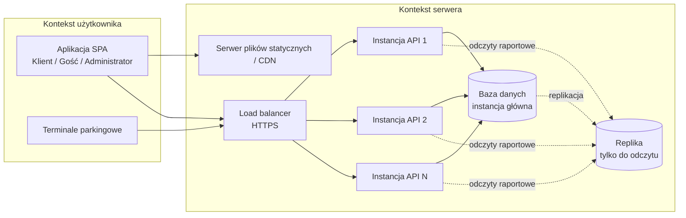

## 3 Architektura
*Diagram perspektywy wdrożenia*

Należy zaprezentować diagram perspektywy wdrożenia obejmujący wszystkie warstwy systemu. Na diagramie należy zaznaczyć granicę pomiędzy tymi częściami
systemu, które działają w kontekście użytkownika (są wykonywane w systemie operacyjnym kontrolowanym przez użytkownika) oraz tymi, które działają w kontekście
serwera (są wykonywane w systemie operacyjnym / systemach operacyjnych kontrolowanym / kontrolowanych przez administratorów wdrożenia systemu).

*Stan konwersacyjny*

Wskazać warstwę systemu, która odpowiada za przechowywanie stanu konwersacyjnego systemu z użytkownikiem (z technicznego punktu widzenia: między klientem a
kontekstem serwera).

*Udostępnienie systemu*

Wskazać protokół sieciowy, który ma być zastosowany do zapewnienia komunikacji między kontekstem użytkownika a kontekstem serwera.
Wskazać zagrożenia dla bezpieczeństwa danych przesyłanych pomiędzy kontekstem klienta a innymi elementami systemu oraz wskazać standardowe rozwiązanie
ochrony danych przed tymi zagrożeniami.

*Skalowalność*

Skalowanie horyzontalne polega na uruchomieniu kilku identycznych instancji danego komponentu i rozdzielaniu między nie
ruchu. Ocenę przeprowadzono osobno dla każdej warstwy zaproponowanej architektury: klient przeglądarkowy (SPA)
i terminale parkingowe → REST API (warstwa logiki) → relacyjna baza danych (warstwa danych) oraz zadania wyzwalane
czasowo (aktor *System*).

Wykres 3.4.1 - Skalowanie horyzontalne warstwy logiki systemu

**1. Warstwa prezentacji (SPA)**

Aplikacja kliencka to zbiór statycznych plików (HTML, JS, CSS) wykonywanych w przeglądarce użytkownika. Serwer jedynie je
udostępnia, więc można je powielić na dowolnej liczbie serwerów lub umieścić w sieci CDN bez żadnej koordynacji między
instancjami. Ta warstwa skaluje się horyzontalnie bez ograniczeń.

**2. Warstwa logiki biznesowej (REST API) - skalowanie możliwe i zalecane**

Warunkiem multiplikowania instancji serwera aplikacji jest jego **bezstanowość**: żadne żądanie nie może zależeć od
danych zapamiętanych w pamięci konkretnej instancji przy poprzednim żądaniu. W proponowanej architekturze warunek ten
jest spełniony:

* stan konwersacyjny przechowuje klient - każde żądanie niesie token dostępu (JWT, zob. rozdz. 7), który każda instancja
  weryfikuje samodzielnie na podstawie wspólnego klucza. Nie jest potrzebna sesja HTTP po stronie serwera ani
  mechanizm *sticky sessions* na load balancerze,
* stan dziedzinowy (rezerwacje, zdarzenia `ParkingEvents`, autoryzacja wyjazdu po opłaceniu postoju - P5) jest
  utrwalany w bazie danych, a nie w pamięci instancji,
* dane ulotne (bieżąca zajętość, liczba wolnych miejsc) są wyliczane na żądanie z bazy, więc każda instancja otrzymuje
  ten sam wynik.

Przed instancjami API umieszcza się load balancer (np. Nginx, HAProxy lub ingress Kubernetesa), który rozdziela żądania
algorytmem round-robin / least-connections, terminuje TLS i usuwa z puli instancje, które nie odpowiadają na sondę
`/health`. Dzięki temu dodawanie i usuwanie instancji (np. w reakcji na obciążenie) nie wymaga zmian po stronie
klientów ani terminali.

Skalowanie horyzontalne wymusza jednak kilka decyzji projektowych:

| Problem                                                     | Skutek przy N instancjach                                                                                                                       | Rozwiązanie                                                                                                                                                                                                                     |
|-------------------------------------------------------------|-------------------------------------------------------------------------------------------------------------------------------------------------|---------------------------------------------------------------------------------------------------------------------------------------------------------------------------------------------------------------------------------|
| Kontrola limitu miejsc (T1, P2)                             | Blokady w pamięci procesu (np. `synchronized`) chronią tylko w obrębie jednej instancji. Dwie instancje mogą jednocześnie przekroczyć `capacity` | Synchronizacja na poziomie bazy danych: blokada pesymistyczna wiersza `Parking` (`SELECT ... FOR UPDATE`) lub blokada optymistyczna z wersjonowaniem (szczegóły w rozdz. 8)                                                    |
| Zadania wyzwalane czasowo (T4, T6, T7, P4, P7)              | Harmonogram uruchomiony w każdej instancji wykona to samo zadanie N razy (np. wielokrotne anulowanie lub zwrot środków)                          | Rozproszona blokada zadania (np. ShedLock oparty o tabelę w bazie) albo wydzielona pojedyncza instancja *worker*; dodatkowo operacje warunkowe, np. `UPDATE ... WHERE isPaid = false AND ...`, dzięki czemu powtórzenie nic nie zmienia |
| Ponowienie żądania przez terminal                           | Terminal po przekroczeniu czasu odpowiedzi może ponowić zgłoszenie wjazdu do innej instancji, co da zdublowane zdarzenie `ENTRY`                | Idempotentny endpoint: terminal przesyła unikalny identyfikator zdarzenia (klucz idempotencji), a baza ma na nim ograniczenie unikalności                                                                                     |
| Pamięć podręczna (cache)                                    | Lokalny cache każdej instancji może zwracać nieaktualną zajętość parkingu                                                                       | Nie buforować danych zmiennych (zajętość) albo użyć współdzielonego cache (np. Redis) z unieważnianiem przy zapisie. Lokalny cache tylko dla danych rzadko zmienianych (parametry `Parking`)                                    |
| Klucz podpisu tokenów, konfiguracja                         | Token wydany przez jedną instancję musi być akceptowany przez pozostałe                                                                         | Wspólny klucz/para kluczy i konfiguracja wstrzykiwane wszystkim instancjom (zmienne środowiskowe, menedżer sekretów)                                                                                                         |
| Identyfikatory encji                                        | Liczniki generowane w pamięci instancji kolidowałyby ze sobą                                                                                   | Identyfikatory `UUID` (zgodnie z modelem danych) generowane niezależnie w każdej instancji                                                                                                                                    |

**3. Warstwa danych - skalowanie ograniczone**

Relacyjna baza danych jest jedynym komponentem współdzielonym przez wszystkie instancje API i to ona wyznacza granicę
skalowalności systemu. Zapisy (tworzenie rezerwacji, rejestracja wjazdów i wyjazdów) wymagają silnej spójności, bo
reguły limitu miejsc muszą być sprawdzane na aktualnych danych. Dlatego zapisy obsługuje jedna instancja główna
(*primary*). Możliwe są natomiast:

* **repliki tylko do odczytu** - przejmują zapytania niewymagające najświeższych danych, np. przegląd historii
  rezerwacji i zdarzeń przez Administratora czy raporty. Odczyty, na podstawie których podejmowana jest decyzja
  (wolne miejsca przy T1 i P2), muszą trafiać do instancji głównej, bo replikacja wprowadza opóźnienie,
* **pula połączeń** - przy N instancjach API łączna liczba połączeń rośnie N-krotnie, więc należy ograniczyć pule
  w instancjach lub zastosować pośrednika (np. PgBouncer),
* **partycjonowanie (sharding) według `parkingId`** - wszystkie reguły biznesowe (pojemność, limity czasowe, zajętość)
  dotyczą pojedynczego parkingu, więc dane różnych parkingów można by rozdzielić między niezależne bazy bez transakcji
  rozproszonych. Jest to naturalna ścieżka rozwoju przy bardzo dużej liczbie parkingów, ale przy obecnej skali
  niepotrzebna,
* **replikacja z automatycznym przełączaniem (failover)** - służy przede wszystkim dostępności, a nie wydajności.

Tabela `ParkingEvents` rośnie stale, a bieżąca zajętość jest z niej wyliczana. Aby ten odczyt nie spowalniał się wraz
z historią, należy zastosować indeks (`parkingId`, `vehicleId`, `eventTime`) oraz ewentualnie partycjonowanie tabeli
po czasie i archiwizację starych zdarzeń.

**4. Ocena końcowa**

| Komponent                    | Skalowanie horyzontalne | Uwagi                                                                         |
|------------------------------|-------------------------|-------------------------------------------------------------------------------|
| SPA (pliki statyczne)        | Pełne                   | Serwer plików / CDN                                                           |
| REST API (warstwa logiki)    | Pełne                   | Bezstanowe instancje za load balancerem, blokady i idempotencja po stronie bazy |
| Zadania wyzwalane czasowo    | Ograniczone             | Jedno wykonanie na raz (rozproszona blokada lub wydzielony worker)             |
| Baza danych - odczyty        | Możliwe                 | Repliki do odczytu dla zapytań raportowych                                    |
| Baza danych - zapisy         | Ograniczone             | Jedna instancja główna; w przyszłości sharding po `parkingId`                 |

Zaproponowana architektura pozwala na skalowanie horyzontalne warstwy logiki bez zmian w kodzie biznesowym, o ile od
początku zachowa się wymienione zasady: brak stanu w pamięci instancji, kontrola współbieżności w bazie danych,
pojedyncze wykonanie zadań harmonogramu i idempotentne endpointy dla terminali. Przy przewidywanej skali systemu
(ruch generowany przez terminale kilku–kilkunastu parkingów i klientów) jedna instancja API wystarczy pod względem
wydajności. Zaleca się jednak uruchomienie co najmniej dwóch instancji, aby awaria lub aktualizacja jednej z nich nie
zatrzymywała obsługi szlabanów. Wąskim gardłem pozostaje instancja główna bazy danych, którą w razie potrzeby skaluje
się najpierw wertykalnie, a dopiero później przez repliki i partycjonowanie.