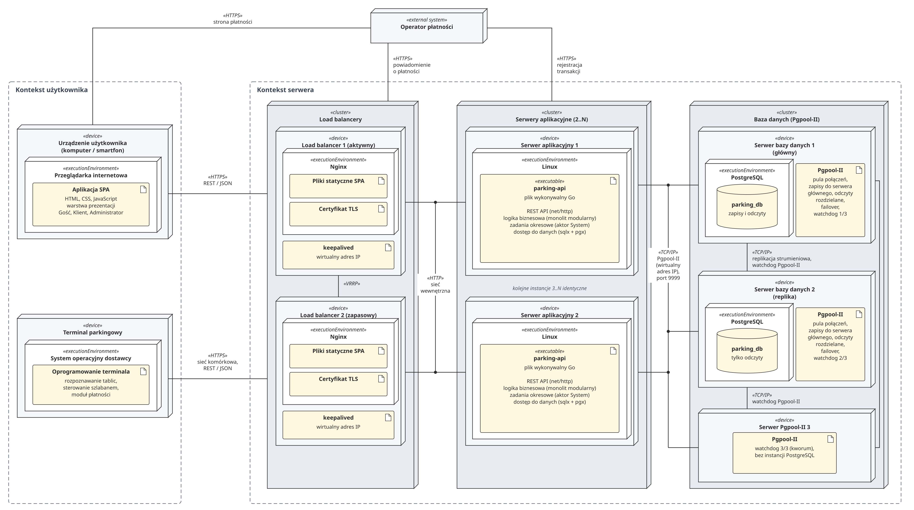

## 3 Architektura
*Diagram perspektywy wdrożenia*

Wykres 3.1.1 - Diagram perspektywy wdrożenia

System składa się z trzech warstw: prezentacji (aplikacja SPA), logiki biznesowej (aplikacja `parking-api` napisana
w Go) i danych (baza PostgreSQL). Diagram dzieli je na dwa konteksty wykonania.

**Kontekst użytkownika** obejmuje urządzenia, których systemu operacyjnego nie kontrolują administratorzy wdrożenia:

* **Urządzenie użytkownika** (komputer lub smartfon) z przeglądarką internetową. Gość, Klient i Administrator korzystają
  z tej samej aplikacji SPA (HTML, CSS, JavaScript), która po pobraniu z serwera działa w całości w przeglądarce
  i komunikuje się z warstwą logiki wyłącznie przez REST API.
* **Terminal parkingowy** z oprogramowaniem dostawcy, które rozpoznaje tablice rejestracyjne, steruje szlabanem
  i przyjmuje płatności. Z serwerem łączy się przez wbudowany modem sieci komórkowej. System operacyjny terminala
  kontroluje dostawca, a nie administratorzy systemu, dlatego terminal jest po stronie kontekstu użytkownika i z punktu
  widzenia serwera jest takim samym klientem REST API jak aplikacja SPA.

**Kontekst serwera** obejmuje maszyny kontrolowane przez administratorów wdrożenia. Każda warstwa działa w kilku
instancjach, więc awaria jednej maszyny nie zatrzymuje systemu. Instancje danej warstwy zgrupowano w klastry
(stereotyp `«cluster»`):

* **Load balancery** - dwie maszyny z Nginx, które udostępniają pliki statyczne aplikacji SPA, terminują połączenia
  HTTPS (certyfikat TLS) i rozdzielają żądania API między serwery aplikacyjne. Działają w trybie aktywny-zapasowy.
  Program keepalived utrzymuje jeden wirtualny adres IP, z którym łączą się przeglądarki, terminale i operator
  płatności. Na co dzień adres obsługuje load balancer 1. Gdy przestaje on odpowiadać, keepalived (protokół VRRP)
  przenosi adres na load balancer 2, więc klienci nie muszą niczego zmieniać. Load balancery są jedynym elementem
  kontekstu serwera dostępnym z Internetu.
* **Serwery aplikacyjne** - co najmniej dwie identyczne maszyny, na każdej działa `parking-api`, czyli jeden plik
  wykonywalny Go (monolit modularny, rozdz. 4). W jednym procesie działają: REST API oparte na `net/http`, logika
  biznesowa, zadania okresowe aktora System i dostęp do danych przez `sqlx`
  ze sterownikiem `pgx`. Instancje nie przechowują stanu, więc
  load balancer może wysłać każde żądanie do dowolnej z nich, a przy większym ruchu dodaje się kolejne (3..N).
  Nginx przestaje kierować żądania do serwera, który nie odpowiada (parametry `max_fails` i `fail_timeout`), i wraca
  do niego, gdy serwer znów działa.
  Zadania okresowe wykonuje w danej chwili tylko jedna instancja (zob. *Skalowalność*).
* **Baza danych** - dwa serwery PostgreSQL z bazą `parking_db` oraz trzecia instancja Pgpool-II. Serwer główny
  przyjmuje wszystkie zapisy, a replika otrzymuje zmiany na bieżąco przez replikację strumieniową. Klastrem zarządza
  **Pgpool-II**, który działa na wszystkich trzech serwerach i pośredniczy w każdym połączeniu z bazą:
  * utrzymuje pulę połączeń i ogranicza ich liczbę do PostgreSQL (parametr `num_init_children`), więc nie rośnie ona
    wraz z liczbą serwerów aplikacyjnych,
  * kieruje zapisy do serwera głównego, a odczyty rozdziela między oba serwery. Replika, której opóźnienie względem
    serwera głównego przekracza ustalony próg (`delay_threshold`), jest pomijana przy rozdzielaniu odczytów,
  * nie rozdziela zapytań `SELECT ... FOR UPDATE` ani zapytań oznaczonych komentarzem `/*NO LOAD BALANCE*/`, tylko
    zawsze wysyła je do serwera głównego. W ten sposób oznaczane są wszystkie zapytania, na podstawie których zapada
    decyzja (np. czy jest wolne miejsce przy T1 i P2), więc decyzja nigdy nie opiera się na opóźnionych danych
    z repliki,
  * sprawdza, czy serwery PostgreSQL odpowiadają, a po awarii serwera głównego uruchamia skrypt failover
    (`failover_command`), który awansuje replikę na serwer główny. Uszkodzony serwer po naprawie administrator
    dołącza z powrotem jako replikę.

  Instancje Pgpool-II pilnują się nawzajem przez mechanizm watchdog i utrzymują jeden wirtualny adres IP, z którym
  łączą się serwery aplikacyjne (port 9999). Gdy instancja trzymająca adres przestaje działać, przejmuje go inna.
  Watchdog podejmuje decyzje większością głosów (kworum), dlatego potrzebuje trzech instancji. Trzecia działa na
  osobnym serwerze bez PostgreSQL i chroni przed sytuacją, w której po utracie łączności oba serwery bazy uznają się
  za główny. Serwery bazy są dostępne tylko z sieci wewnętrznej.

Połączenia między warstwami nie są pojedynczymi łączami. Każdy load balancer może przekazać żądanie do każdego
serwera aplikacyjnego, a każdy serwer aplikacyjny łączy się z wirtualnym adresem Pgpool-II, który może przejąć
dowolna z trzech instancji (na diagramie wspólna linia z rozgałęzieniami). Awaria jednej maszyny w dowolnej warstwie
nie odcina pozostałych.

Poza oboma kontekstami znajduje się **Operator płatności**, czyli zewnętrzny system obsługujący płatności internetowe
za rezerwacje (przejście T2). Płatność przebiega w trzech krokach: serwer aplikacyjny rejestruje transakcję
u operatora, przeglądarka Klienta przechodzi na stronę płatności operatora, a po jej zakończeniu operator powiadamia
system o wyniku żądaniem HTTPS na wirtualny adres load balancerów. Dopiero to powiadomienie ustawia `isPaid = true`,
bo przeglądarce nie można ufać, że płatność się powiodła.

Linie między węzłami to ścieżki komunikacyjne, a stereotyp przy każdej z nich wskazuje protokół:

| Ścieżka komunikacyjna                       | Protokół                                                   |
|---------------------------------------------|------------------------------------------------------------|
| Urządzenie użytkownika - load balancery     | HTTPS, REST / JSON                                         |
| Terminal parkingowy - load balancery        | HTTPS przez sieć komórkową, REST / JSON                    |
| Urządzenie użytkownika - operator płatności | HTTPS (strona płatności operatora)                         |
| Operator płatności - load balancery         | HTTPS (powiadomienie o wyniku płatności)                   |
| Serwery aplikacyjne - operator płatności    | HTTPS (rejestracja transakcji)                             |
| Load balancer 1 - load balancer 2           | VRRP (kontrola, który utrzymuje wirtualny adres)           |
| Load balancery - serwery aplikacyjne        | HTTP w sieci wewnętrznej                                   |
| Serwery aplikacyjne - Pgpool-II             | protokół PostgreSQL po TCP (wirtualny adres IP, port 9999) |
| Pgpool-II - PostgreSQL                      | protokół PostgreSQL po TCP (port 5432)                     |
| Serwer bazy danych 1 - serwer bazy danych 2 | replikacja strumieniowa PostgreSQL po TCP                  |
| Instancje Pgpool-II między sobą             | watchdog Pgpool-II po TCP                                  |

Źródło diagramu: `img/wdrozenie.svg` (można edytować np. w Inkscape lub draw.io).

*Stan konwersacyjny*

Wskazać warstwę systemu, która odpowiada za przechowywanie stanu konwersacyjnego systemu z użytkownikiem (z technicznego punktu widzenia: między klientem a
kontekstem serwera).

*Udostępnienie systemu*

Wskazać protokół sieciowy, który ma być zastosowany do zapewnienia komunikacji między kontekstem użytkownika a kontekstem serwera.
Wskazać zagrożenia dla bezpieczeństwa danych przesyłanych pomiędzy kontekstem klienta a innymi elementami systemu oraz wskazać standardowe rozwiązanie
ochrony danych przed tymi zagrożeniami.

*Skalowalność*

Ocenić możliwość zastosowania skalowania horyzontalnego (multiplikowania instancji) do zaproponowanej architektury systemu.